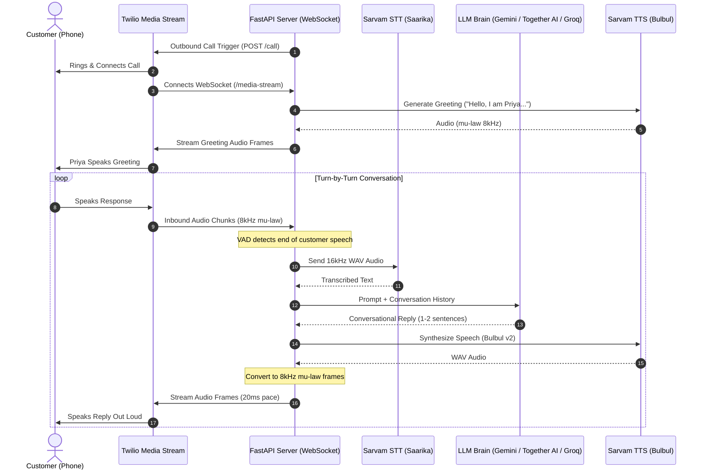

# AI Telecaller Prototype (Twilio + Sarvam AI + LLM)

An end-to-end autonomous voice telecaller designed for natural, ultra-low latency conversations. It connects **Twilio Media Streams** (bidirectional WebSockets) with **Sarvam AI** (Indian language STT & TTS) and fast conversational LLMs (**Gemini**, **Together AI**, or **Groq**).

---

## Architecture Flow



---

## Directory Structure

```
ai_telecaller/
├── app/
│   ├── __init__.py
│   ├── config.py           # Configuration & environment variables
│   ├── audio.py            # G.711 mu-law, resampling (8k<->16k), RMS VAD, WAV builder
│   ├── sarvam_client.py    # Sarvam AI STT (Saarika) & TTS (Bulbul) client
│   ├── llm_client.py       # Conversational LLM client (Gemini, Together AI, Groq, OpenAI)
│   ├── telecaller.py       # WebSocket session, turn state machine & VAD
│   └── main.py             # FastAPI app, /call, /twiml, & /media-stream endpoints
├── requirements.txt        # Python dependencies
├── .env.example            # Environment configuration template
└── README.md               # Documentation & setup guide
```

---

## 1. Quickstart Setup

### Step 1: Create Virtual Environment
```bash
python3 -m venv venv
source venv/bin/activate
pip install -r requirements.txt
```

### Step 2: Configure Environment
Copy `.env.example` to `.env`:
```bash
cp .env.example .env
```
Fill in your credentials in `.env`:
- **Twilio**: `TWILIO_ACCOUNT_SID`, `TWILIO_AUTH_TOKEN`, `TWILIO_PHONE_NUMBER`
- **Sarvam AI**: `SARVAM_API_KEY`
- **LLM Brain**:
  - For Gemini (recommended): `LLM_PROVIDER=gemini` and set `GEMINI_API_KEY`
  - For Together AI: `LLM_PROVIDER=together` and set `TOGETHER_API_KEY`
  - For Groq: `LLM_PROVIDER=groq` and set `GROQ_API_KEY`

---

## 2. Expose the Server Publicly (ngrok)

Twilio requires a public HTTPS/WSS URL to reach your local server.

```bash
ngrok http 8000
```

Copy the forwarding domain (e.g., `abc123-xyz.ngrok-free.app` — **without** `https://`) and paste it into `.env`:
```env
PUBLIC_HOSTNAME=abc123-xyz.ngrok-free.app
```

---

## 3. Run the Server

```bash
uvicorn app.main:app --host 0.0.0.0 --port 8000 --reload
```

Interactive API documentation will be available at:
`http://localhost:8000/docs`

---

## 4. Trigger an Outbound Call

To initiate a call to any target phone number:

```bash
curl -X POST "http://localhost:8000/call?to=%2B919876543210"
```
*(Replace `%2B919876543210` with the E.164 phone number, e.g. `+919876543210` URL-encoded).*

When the recipient answers:
1. The AI voice assistant ("Priya") greets the caller.
2. Voice Activity Detection listens to the customer's response.
3. Sarvam AI transcribes speech into text.
4. The conversational LLM drafts a concise reply.
5. Sarvam TTS speaks it directly into the live phone call.

---

## 5. Voice Activity Detection (VAD) Tuning

- `SILENCE_RMS_THRESHOLD`: Default is `450.0`. If the bot interrupts too early while the customer is still speaking, raise this to `550.0` or `600.0`. If the bot does not detect speech, lower it to `350.0`.
- `SILENCE_DURATION_MS`: Default is `850` milliseconds. Adjust this if you want the bot to wait slightly longer before answering.
